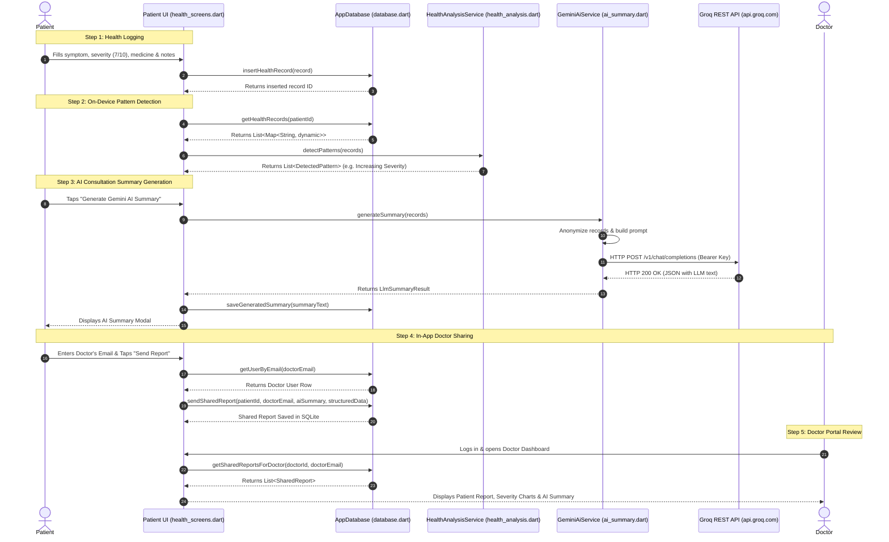
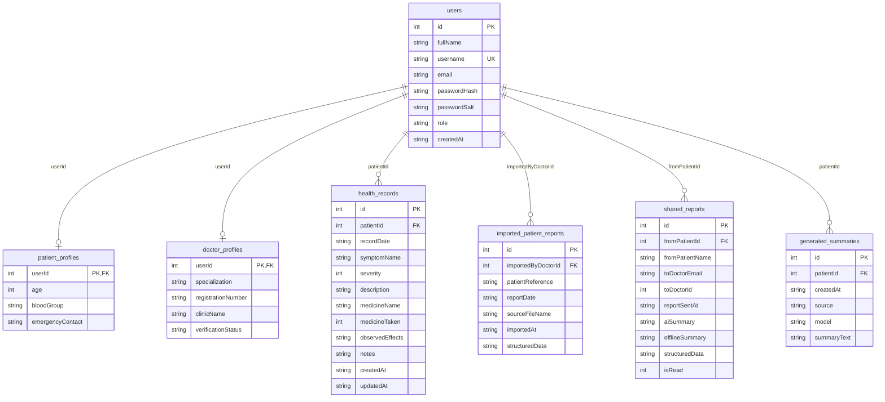

# CareTimeline: Offline-First Health Tracking, Pattern Analysis & AI Clinical Summarization

CareTimeline is an **offline-first, cross-platform personal health management and clinical decision support system** built with Flutter, SQLite, Dart, and Groq/Gemini Large Language Model (LLM) REST APIs. It empowers patients to log daily symptoms, severity levels, medication intake, and observed side effects locally on their device, automatically detects recurring symptom patterns and severity trends, generates structured consultation reports (PDF/JSON), and produces clinical AI summaries for physician review.

---

## Section 1: Project Overview

### Problem Statement
Patients suffering from chronic conditions, recurring migraines, seasonal allergies, or undergoing post-operative recovery often struggle to accurately recall symptom frequency, severity fluctuations, medication adherence, and side effects when meeting their consulting physician. Verbal recall during short 10-minute doctor appointments is error-prone, leading to incomplete medical histories, overlooked symptom spikes, and inaccurate treatment adjustments. Furthermore, existing health-tracking mobile applications frequently depend on mandatory cloud backends, requiring continuous internet connectivity and risking sensitive patient privacy.

### Why the Project is Needed
CareTimeline solves this critical communication gap by providing an offline-first digital health diary that works 100% locally without requiring internet access, user registration on external servers, or mandatory cloud subscriptions. It acts as an objective, chronological health timeline that automatically processes patient entries, detects progressive health trends, and transforms raw patient logs into structured, factual clinical reports suitable for immediate review by healthcare professionals.

### Main Objective
To bridge the gap between patient self-reporting and clinical physician evaluation by building a privacy-preserving, offline-first application that automates health pattern recognition, structures health data into clinical formats (PDF/JSON), and leverages AI to generate factual consultation summaries.

### Target Users
1. **Patients / Caregivers**: Individuals tracking personal symptoms, medication doses, and side effects over time.
2. **Consulting Physicians / Doctors**: Healthcare professionals reviewing patient-reported health histories, severity progression charts, and AI clinical summaries during appointments.

### Real-World Use Case
A patient experiencing recurring migraines logs their headache severity (1 to 10), medicine taken (e.g., Paracetamol 500mg), and observed side effects (e.g., drowsiness) over two weeks. When visiting their neurologist:
- The app automatically detects an **Increasing Severity Trend** (e.g., severity rose from 4/10 to 7/10 across consecutive logs).
- The patient generates a **Gemini/Groq AI Clinical Summary** or exports a **Clinical PDF Report**.
- The patient sends the report directly to the doctor's in-app account using the doctor's registered email address.
- The doctor logs into their **Doctor Portal**, views the interactive severity charts, reviews the AI summary, and makes an informed prescription adjustment.

### Main Features
- **Offline-First Storage**: All health records, patient profiles, and shared reports are stored in an encrypted local SQLite database using `sqflite`.
- **Role-Based Authentication**: Dual user portals for Patients and Doctors, protected by SHA-256 salted password hashing and Flutter Secure Storage session management.
- **Rule-Based Health Pattern Analysis**: An on-device Dart analysis engine that detects recurring symptoms, escalating severity trends (3 consecutive increases), and repeated medication-observation correlations.
- **Interactive Visual Analytics**: Dynamic symptom severity line charts built with `fl_chart`, supporting filtering by specific symptoms and date ranges.
- **AI Consultation Summarizer & Assistant**: Integration with Groq (Llama 3.3 / GPT-OSS) and Google Gemini REST APIs to generate clinical summaries and answer health timeline questions.
- **In-App Patient-to-Doctor Report Sharing**: Direct sharing of health records and AI summaries to a doctor's registered email within the local database context.
- **Multi-Format Export & Import**: Secure JSON export/import with versioned schema validation (`schemaVersion: 1.0.0`) and professional PDF report generation via `pdf` and `printing`.

### What Makes the Project Useful or Different
1. **100% Offline Resilience**: Unlike traditional cloud-dependent health apps, CareTimeline performs user authentication, database operations, pattern recognition, and offline rule-based summarization without needing an active internet connection.
2. **Deterministic Fallbacks**: If internet connectivity is lost or AI keys are unavailable, the system automatically falls back to an on-device rule-based clinical analysis engine without crashing or displaying empty screens.
3. **Medical Safety & Non-Diagnostic Guardrails**: All AI prompts and local rules enforce strict clinical guardrails: no clinical diagnosis, no prescription recommendations, and strict treatment of user notes as correlative observations rather than proven medical causation.

### 30–60 Second Interview Overview
> "CareTimeline is an offline-first Flutter application designed to convert raw patient health logs into actionable clinical consultation reports. It uses an embedded SQLite database with SHA-256 salted password hashing to store patient symptoms, severity levels (1–10), and medication logs locally. On the device, a deterministic Dart analysis engine identifies health trends such as escalating symptom severity and recurring side effects. Patients can visualize their progress using dynamic `fl_chart` line graphs, export PDF/JSON reports, or generate AI-assisted clinical summaries using Groq or Google Gemini REST APIs. The app also features a Doctor Portal where physicians can review imported or in-app shared patient reports."

---

## Section 2: Technology Stack

| Technology / Library | Purpose in CareTimeline | Where Used | Why Suitable | Possible Interview Question |
| :--- | :--- | :--- | :--- | :--- |
| **Flutter (v3.x / Dart 3.12)** | Cross-platform UI Framework & Language | Entire codebase (`lib/`) | Provides native performance on Android, iOS, and Desktop from a single codebase with declarative UI state management. | *What is the difference between `StatefulWidget` and `StatelessWidget`, and how does Flutter manage the widget tree during `setState()`?* |
| **SQLite (`sqflite` ^2.4.4)** | Embedded Relational Database | `lib/database.dart` | Lightweight, zero-configuration local relational database supporting SQL transactions, foreign keys, and performance indexing. | *How do SQLite database migrations work in `sqflite`, and how do you enforce foreign key constraints?* |
| **Flutter Secure Storage (`flutter_secure_storage` ^11.2.0)** | Encrypted Key-Value Storage | `lib/auth_service.dart`, `lib/ai_summary.dart` | Uses Android Keystore and iOS Keychain to securely persist user session tokens and API keys. | *Why should sensitive data like session keys not be stored in standard `SharedPreferences`?* |
| **Crypto (`crypto` ^3.0.7)** | Cryptographic Password Hashing | `lib/auth_service.dart` | Provides SHA-256 hashing to secure user passwords alongside a 16-byte cryptographically secure random salt. | *Why is password salting necessary, and how does SHA-256 hashing protect against rainbow table attacks?* |
| **FL Chart (`fl_chart` ^1.2.0)** | Interactive Charting Library | `lib/health_screens.dart`, `lib/doctor_dashboard.dart` | Renders high-performance vector severity trend line charts with customizable touch tooltips and grid lines. | *How do you map raw database timestamp records into numerical X/Y coordinates for `fl_chart`?* |
| **HTTP (`http` ^1.6.0)** | REST API Client | `lib/ai_summary.dart` | Performs asynchronous HTTP POST requests to Groq and Gemini AI REST endpoints with custom headers and timeout handling. | *How do you handle network timeouts and HTTP error status codes (e.g., 400, 403, 429) in Dart async calls?* |
| **PDF & Printing (`pdf` ^3.13, `printing` ^5.15)** | PDF Document Generation & Sharing | `lib/report_service.dart` | Generates multi-page vector PDF documents containing clinical headers, tables, and disclaimers natively on the device. | *How does `pdf` library build multi-page documents, and how do you pass custom styling?* |
| **Share Plus (`share_plus` ^13.3.1)** | Platform File Sharing | `lib/report_service.dart` | Invokes native Android/iOS share dialogs to export JSON report files to external apps like WhatsApp or Email. | *How does `share_plus` interact with native OS file providers?* |
| **File Picker (`file_picker` ^13.1.0)** | Native File Explorer Picker | `lib/doctor_dashboard.dart` | Allows doctors to browse local device storage and import `.json` patient health reports. | *How do you validate custom file extensions and handle cancellation in `file_picker`?* |
| **Intl (`intl` ^0.20.3)** | Date Formatting & Parsing | `lib/health_screens.dart`, `lib/report_service.dart` | Formats ISO-8601 strings into human-readable clinical timestamps (e.g., `yyyy-MM-dd HH:mm`). | *Why is ISO-8601 preferred for storing dates in SQLite over localized strings?* |

---

## Section 3: Complete Project Structure

```
ai project care/
├── android/                        # Android Native Project Configuration
│   ├── app/
│   │   ├── build.gradle.kts        # Android build config (Java 17, SDK target, app namespace)
│   │   └── src/main/AndroidManifest.xml # Android permissions (Internet, Storage)
│   └── build.gradle.kts            # Top-level Gradle configuration
├── lib/                            # Core Dart Application Source Code
│   ├── main.dart                   # Entry point, session check, app theme & root routing
│   ├── database.dart               # SQLite database singleton, schema creation & CRUD operations
│   ├── auth_service.dart           # User model, PBKDF2/SHA-256 salted auth & secure session storage
│   ├── auth_screens.dart           # Patient/Doctor registration, login & role selection UI
│   ├── health_analysis.dart        # On-device pattern detection engine & offline rule-based summary
│   ├── health_screens.dart         # Patient Dashboard (Overview, Timeline, Trends, Reports, Profile, AI Assistant)
│   ├── doctor_dashboard.dart       # Doctor Portal (Imported/Shared reports viewer, analytical charts)
│   ├── ai_summary.dart             # Groq/Gemini REST API integration, prompt engineering & error handling
│   ├── app_config.dart             # API keys, base URLs, model fallback lists & configuration
│   └── report_service.dart         # JSON export/import schema validator & PDF report generator
├── test/                           # Unit & Widget Test Suite
│   ├── widget_test.dart            # Unit tests for pattern analysis, JSON validation & UI rendering
│   └── ai_summary_test.dart        # Unit tests for AI prompt construction, JSON parsing & error classification
├── pubspec.yaml                    # Flutter package manifest, dependencies & metadata
└── README.md                       # Complete technical documentation & interview guide
```

### Detailed File Responsibilities

#### `lib/main.dart`
- **Purpose**: Application entry point and root widget controller.
- **Responsibilities**: Initializes Flutter widget bindings, triggers SQLite database initialization (`AppDatabase.instance.database`), checks secure storage for active user sessions (`AuthService.instance.getCurrentSession()`), configures global Material 3 theme colors (`#00796B` Healthcare Teal), and handles top-level navigation between `WelcomeScreen`, `PatientDashboardScreen`, and `DoctorDashboardScreen`.
- **Key Classes/Methods**: `main()`, `CareTimelineApp`, `_CareTimelineAppState._restoreSession()`.
- **Communicates With**: `auth_service.dart`, `database.dart`, `auth_screens.dart`, `health_screens.dart`, `doctor_dashboard.dart`.
- **Failure Impact**: App fails to start, database is not initialized, or user session state is lost.

#### `lib/database.dart`
- **Purpose**: Singleton SQLite database manager.
- **Responsibilities**: Manages database lifecycle (creation, schema migrations v1->v4, connection pooling), defines 7 relational tables, enforces foreign key constraints (`PRAGMA foreign_keys = ON`), defines B-Tree performance indexes, and exposes thread-safe CRUD methods for users, health records, profiles, imported reports, shared reports, and AI summaries.
- **Key Classes/Methods**: `AppDatabase`, `_initDatabase()`, `_onCreate()`, `_onUpgrade()`, `getHealthRecords()`, `sendSharedReport()`, `getSharedReportsForDoctor()`.
- **Communicates With**: `sqflite`, `path`, `auth_service.dart`, `health_screens.dart`, `doctor_dashboard.dart`.
- **Failure Impact**: Total application data loss, inability to read/write health entries or accounts.

#### `lib/auth_service.dart`
- **Purpose**: User authentication and session security manager.
- **Responsibilities**: Defines `AppUser` data model, generates 16-byte random salts using `Random.secure()`, computes SHA-256 password hashes, registers patient and doctor accounts, validates duplicate usernames/emails, handles user login, and persists active sessions in `FlutterSecureStorage`.
- **Key Classes/Methods**: `AppUser`, `AuthService`, `registerPatient()`, `registerDoctor()`, `login()`, `_generateSalt()`, `_hashPassword()`, `_saveSession()`, `getCurrentSession()`.
- **Communicates With**: `crypto`, `flutter_secure_storage`, `database.dart`.
- **Failure Impact**: Security vulnerability, passwords stored in plaintext, or login state failing to persist.

#### `lib/auth_screens.dart`
- **Purpose**: UI screens for user onboarding, authentication, and registration.
- **Responsibilities**: Renders `WelcomeScreen` with role selection sheet, `PatientRegisterScreen` for patient onboarding, `DoctorRegisterScreen` for physician onboarding, and `LoginScreen` with form field validation, error feedback, and scrollable layouts.
- **Key Classes/Methods**: `WelcomeScreen`, `PatientRegisterScreen`, `DoctorRegisterScreen`, `LoginScreen`.
- **Communicates With**: `auth_service.dart`, `health_screens.dart`, `doctor_dashboard.dart`.
- **Failure Impact**: Users cannot sign up or log in.

#### `lib/health_analysis.dart`
- **Purpose**: Deterministic, on-device health pattern recognition engine.
- **Responsibilities**: Defines `DetectedPattern` model and `HealthAnalysisService`. Executes Dart algorithms to identify recurring symptoms (case-normalized), escalating severity progression trends (3 consecutive increases), repeated medication side-effect correlations, and generates local rule-based clinical summaries when offline.
- **Key Classes/Methods**: `DetectedPattern`, `HealthAnalysisService`, `detectPatterns()`, `generateOfflineSummary()`.
- **Communicates With**: `health_screens.dart`, `doctor_dashboard.dart`, `report_service.dart`.
- **Failure Impact**: Loss of automated trend analysis and offline clinical summary generation.

#### `lib/health_screens.dart`
- **Purpose**: Main Patient Portal interface.
- **Responsibilities**: Renders 5-tab NavigationBar (`Overview`, `Timeline`, `Trends`, `Reports`, `Profile`). Includes health record entry modal (`AddEditRecordScreen`), interactive `fl_chart` severity line graphs, in-app doctor report sharing dialogs, API key manager, and `CareTimeline AI Assistant` bottom sheet.
- **Key Classes/Methods**: `PatientDashboardScreen`, `AddEditRecordScreen`, `_buildOverviewTab()`, `_buildTrendsTab()`, `_generateAiSummary()`, `_showAiAssistantBottomSheet()`.
- **Communicates With**: `database.dart`, `health_analysis.dart`, `ai_summary.dart`, `report_service.dart`, `fl_chart`.
- **Failure Impact**: Patients cannot log health data, view trends, or export summaries.

#### `lib/doctor_dashboard.dart`
- **Purpose**: Main Doctor Portal interface.
- **Responsibilities**: Renders physician dashboard for reviewing patient reports. Supports JSON file importing via `file_picker`, in-app shared report inbox, unread notification badges, interactive patient severity charts, and PDF export for clinical notes.
- **Key Classes/Methods**: `DoctorDashboardScreen`, `DoctorReportViewerScreen`, `_importPatientReport()`, `_loadDashboardData()`.
- **Communicates With**: `database.dart`, `report_service.dart`, `health_analysis.dart`, `file_picker`, `fl_chart`.
- **Failure Impact**: Physicians cannot import or review shared patient records.

#### `lib/ai_summary.dart`
- **Purpose**: REST API service for AI clinical summarization and chat assistant.
- **Responsibilities**: Communicates with Groq (`api.groq.com`) and Google Gemini (`generativelanguage.googleapis.com`) REST APIs. Builds anonymized JSON prompts, parses LLM responses, handles HTTP errors (400, 403, 429), and implements multi-model fallback retry loops (`openai/gpt-oss-20b`, `gemini-1.5-flash`).
- **Key Classes/Methods**: `GeminiAiService`, `generateSummary()`, `askAiAssistant()`, `_callGroqSummary()`, `buildSummaryPrompt()`, `classifyHttpError()`.
- **Communicates With**: `http`, `app_config.dart`, `health_analysis.dart`, `health_screens.dart`.
- **Failure Impact**: AI summaries fail to generate or crash upon network error.

#### `lib/app_config.dart`
- **Purpose**: Centralized application configuration and API endpoints.
- **Responsibilities**: Holds base URLs, integrated API keys, model priority lists for Groq and Gemini, and endpoint builder functions.
- **Key Classes/Methods**: `AppConfig`, `defaultApiKey`, `groqBaseUrl`, `groqModels`, `geminiModels`, `geminiEndpointWithKey()`.
- **Communicates With**: `ai_summary.dart`.
- **Failure Impact**: Hardcoded endpoint mismatches or key resolution errors across the application.

#### `lib/report_service.dart`
- **Purpose**: Document generation, serialization, and schema validation.
- **Responsibilities**: Serializes patient timeline records into JSON format (`schemaVersion: 1.0.0`), validates imported JSON payloads against required fields and severity range constraints (1–10), triggers native file sharing via `share_plus`, and builds vector PDF consultation reports using `pdf` and `printing`.
- **Key Classes/Methods**: `ReportService`, `exportAndShareJson()`, `validateAndParseJsonReport()`, `generateAndSharePdf()`.
- **Communicates With**: `pdf`, `printing`, `share_plus`, `path_provider`, `health_analysis.dart`.
- **Failure Impact**: Inability to export JSON/PDF reports or import invalid JSON files causing runtime crashes.

---

## Section 4: Architecture and Complete Application Flow

### Architectural Pattern: Layered Offline-First Architecture
CareTimeline follows a clean **Layered Architecture** with strict separation of concerns:

```
+-----------------------------------------------------------------------+
|                         PRESENTATION LAYER                            |
|    (Flutter UI Widgets, Material 3 Theme, NavigationBar, Dialogs)    |
|   [WelcomeScreen]  [PatientDashboard]  [DoctorDashboard]  [Charts]    |
+----------------------------------- brilliance ------------------------+
                                    |
                                    v
+-----------------------------------------------------------------------+
|                           SERVICE LAYER                               |
|   (Authentication, Business Logic, PDF/JSON Export, AI Integration)   |
|   [AuthService]   [HealthAnalysisService]   [GeminiAiService]        |
|                  [ReportService]                                      |
+-----------------------------------------------------------------------+
                                    |
                                    v
+-----------------------------------------------------------------------+
|                          DATA LOCAL LAYER                             |
|          (Embedded Database & Encrypted Hardware Storage)             |
|   [AppDatabase - SQLite (sqflite)]   [FlutterSecureStorage]           |
+-----------------------------------------------------------------------+
                                    |
                                    v (Optional REST API Call)
+-----------------------------------------------------------------------+
|                          REMOTE AI LAYER                              |
|            (Groq Llama 3.3 REST API / Gemini REST API)                |
+-----------------------------------------------------------------------+
```

### Complete Mermaid Architecture & Data Flow Diagram



### Step-by-Step Application Execution Flow

1. **Application Launch**:
   - `main()` calls `WidgetsFlutterBinding.ensureInitialized()`.
   - `AppDatabase.instance.database` is awaited, opening `care_timeline.db`, executing `PRAGMA foreign_keys = ON`, and verifying database schema v4.
   - `_CareTimelineAppState` executes `AuthService.instance.getCurrentSession()`, reading encrypted session keys from `FlutterSecureStorage`.
   - If session is active, the app routes directly to `PatientDashboardScreen` or `DoctorDashboardScreen` based on `user.role`. Otherwise, it presents `WelcomeScreen`.

2. **User Interaction & Input Validation**:
   - Patient taps FloatingActionButton **Log Health** -> opens `AddEditRecordScreen`.
   - Form fields (Symptom Name, Severity 1–10 Slider, Date/Time, Medicine Name, Taken Checkbox, Observed Effects) validate input.
   - Severity is constrained between 1 and 10 at both UI form level and SQLite `CHECK(severity >= 1 AND severity <= 10)` table level.

3. **Business Logic & Pattern Analysis Processing**:
   - Upon saving, record is written to SQLite `health_records` table with `createdAt` and `updatedAt` ISO-8601 timestamps.
   - `PatientDashboardScreen` triggers `_loadRecords()`, fetching chronological records.
   - `HealthAnalysisService.instance.detectPatterns(_records)` processes the logs in memory:
     - Case-normalizes symptom names (`headache` == `Headache`).
     - Checks for >= 2 occurrences (Recurring Symptom).
     - Checks chronological severity for 3 consecutive increases (`recent3[0] < recent3[1] <= recent3[2]`).
     - Aggregates medication intake and user-reported side effects.

4. **AI Summary Generation & REST API Call**:
   - Patient navigates to **Reports** tab and taps **Generate Gemini AI Summary**.
   - `_generateAiSummary()` reads API key from `GeminiAiService.instance.getApiKey()`.
   - `GeminiAiService.anonymizeRecords()` strips personal identifiers (names, IDs) and constructs a structured JSON payload containing date, symptom, severity, medicine, taken status, and observed effects.
   - If key starts with `gsk_`, HTTP POST is dispatched to Groq REST API `https://api.groq.com/openai/v1/chat/completions` using `openai/gpt-oss-20b` model.
   - The returned LLM text is formatted with clinical disclaimers and saved to SQLite `generated_summaries` table via `saveGeneratedSummary()`.

5. **In-App Doctor Report Transfer**:
   - Patient enters doctor's email address in **Send to Doctor** dialog.
   - `AppDatabase.instance.getUserByEmail(doctorEmail)` checks if a matching doctor account exists.
   - Report JSON payload, AI summary, and local offline summary are written to SQLite `shared_reports` table.
   - When doctor logs in, `getSharedReportsForDoctor()` fetches all reports directed to their email address, updating unread notification badges in real time.

---

## Section 5: Every Feature Explained

### Feature 1: Role-Based User Authentication & Session Security
- **Purpose**: Secures patient and doctor data, preventing unauthorized access to personal health timelines.
- **Problem Solved**: Replaces insecure plaintext storage with cryptographic authentication and persistent session tokens.
- **Access Route**: App startup -> `WelcomeScreen` -> `PatientRegisterScreen` / `DoctorRegisterScreen` / `LoginScreen`.
- **Internal Working**:
  - `AuthService.registerPatient()` generates a 16-byte cryptographically secure random salt (`Random.secure()`).
  - Computes `sha256("$salt:$password")`.
  - Performs an atomic SQLite transaction inserting rows into `users` and `patient_profiles`.
  - Saves encrypted session tokens (`session_user_id`, `session_role`) into `FlutterSecureStorage`.
- **Relevant Code**: `lib/auth_service.dart` (`registerPatient`, `login`, `_hashPassword`), `lib/database.dart` (`users` table).
- **Input/Output**: Inputs: Full Name, Username, Email, Password. Outputs: Authenticated `AppUser` session object.
- **Error Handling**: Throws explicit exceptions for duplicate usernames, duplicate emails, short passwords (<6 chars), or incorrect credentials.

### Feature 2: Offline Health Logging & Management
- **Purpose**: Allows patients to log symptoms, severity levels, medicines, and observed effects.
- **Problem Solved**: Eliminates reliance on paper diaries or memory recall during doctor appointments.
- **Access Route**: `PatientDashboardScreen` -> FloatingActionButton **Log Health** -> `AddEditRecordScreen`.
- **Internal Working**:
  - UI provides an interactive Material 3 slider for severity (1 to 10), date/time picker, and text fields for medication name and side effects.
  - On submit, executes `AppDatabase.instance.insertHealthRecord()` or `updateHealthRecord()`.
- **Relevant Code**: `lib/health_screens.dart` (`AddEditRecordScreen`), `lib/database.dart` (`health_records` table).
- **Database Interaction**: Direct SQL `INSERT` / `UPDATE` on `health_records` table.

### Feature 3: On-Device Health Pattern Detection Engine
- **Purpose**: Automatically identifies recurring symptoms, severity escalation trends, and medication side effects.
- **Problem Solved**: Uncovers hidden health patterns that patients might miss when looking at raw date logs.
- **Access Route**: `PatientDashboardScreen` -> **Overview** tab -> **Detected Health Patterns** section.
- **Internal Working**:
  - `HealthAnalysisService.detectPatterns()` accepts `List<Map<String, dynamic>> records`.
  - Applies 3 deterministic rules in pure Dart:
    1. **Recurring Symptom**: Group by `trim().toLowerCase()`; flags if count >= 2.
    2. **Escalating Severity**: Sorts chronologically; checks if last 3 entries satisfy `sev[0] < sev[1] <= sev[2]`.
    3. **Medication Observation**: Aggregates `observedEffects` where `medicineTaken == 1`; flags if frequency >= 2.
- **Relevant Code**: `lib/health_analysis.dart` (`detectPatterns()`, `DetectedPattern`).

### Feature 4: Interactive Symptom Severity Analytics & Charting
- **Purpose**: Provides visual trend lines showing symptom severity changes over time.
- **Problem Solved**: Replaces table rows of numbers with intuitive line graphs.
- **Access Route**: `PatientDashboardScreen` -> **Trends** tab (and Doctor Report Viewer).
- **Internal Working**:
  - Filters records by selected symptom name or date range.
  - Maps date strings to index numbers ($X$-axis) and severity numbers 1–10 ($Y$-axis).
  - Renders `fl_chart.LineChart` with custom line colors, dot indicators, and touch tooltips.
- **Relevant Code**: `lib/health_screens.dart` (`_buildTrendsTab()`), `lib/doctor_dashboard.dart`.

### Feature 5: Groq & Gemini AI Clinical Summarization & Chat Assistant
- **Purpose**: Generates factual clinical consultation summaries and answers patient health questions using LLMs.
- **Problem Solved**: Prepares a 1-page clinical summary optimized for physician reading.
- **Access Route**: `PatientDashboardScreen` -> **Reports** tab -> **Generate Gemini AI Summary** / **Ask AI Assistant ✨**.
- **Internal Working**:
  - Checks secure storage or `AppConfig.defaultApiKey` for active API key.
  - Anonymizes records into structured JSON payload.
  - Dispatches HTTP POST to Groq (`openai/gpt-oss-20b`) or Gemini REST API.
  - Parses LLM output, formats with clinical disclaimers, and saves summary in SQLite `generated_summaries` table.
- **Relevant Code**: `lib/ai_summary.dart`, `lib/app_config.dart`.

### Feature 6: In-App Patient-to-Doctor Report Sharing
- **Purpose**: Allows patients to transfer health reports directly to their doctor's in-app account.
- **Problem Solved**: Enables direct digital delivery of health reports without printing paper.
- **Access Route**: **Reports** tab -> **Send Summary to Doctor** dialog.
- **Internal Working**:
  - Patient enters doctor's registered email address.
  - Queries `users` table for matching doctor user.
  - Inserts row into `shared_reports` table containing JSON structured data, AI summary, and offline summary.
  - Updates unread notification badge on doctor's dashboard.
- **Relevant Code**: `lib/health_screens.dart` (`_showSendToDoctorDialog`), `lib/database.dart` (`sendSharedReport`).

### Feature 7: Versioned JSON Export & Schema-Validated Import
- **Purpose**: Supports file-based report sharing and backup.
- **Problem Solved**: Allows doctors to import offline report files via USB, Email, or File Explorer.
- **Access Route**: Doctor Portal -> **Import JSON Report** button -> File Picker.
- **Internal Working**:
  - `ReportService.exportAndShareJson()` writes structured JSON file (`schemaVersion: 1.0.0`) to temporary directory and triggers `SharePlus`.
  - `ReportService.validateAndParseJsonReport()` verifies JSON syntax, root keys, schema version, record types, and severity range (1–10).
  - Doctor confirms import -> inserted into `imported_patient_reports` table.
- **Relevant Code**: `lib/report_service.dart`, `lib/doctor_dashboard.dart` (`_importPatientReport`).

### Feature 8: Vector PDF Consultation Report Generator
- **Purpose**: Generates printable PDF clinical reports.
- **Problem Solved**: Provides physical paperwork for hospitals or clinical archives.
- **Access Route**: **Reports** tab -> **Export PDF Report** button.
- **Internal Working**:
  - Builds multi-page PDF document using `pdf/widgets.dart`.
  - Includes clinical header, patient reference code, disclaimer box, AI summary, detected health patterns, and chronological data table.
  - Opens native Android/iOS print and preview sheet via `Printing.sharePdf()`.
- **Relevant Code**: `lib/report_service.dart` (`generateAndSharePdf`).

---

## Section 6: Database Deep Dive

CareTimeline uses **SQLite** via the `sqflite` plugin (Database version: 4). Foreign key enforcement is enabled at runtime using `PRAGMA foreign_keys = ON`.

### Database Schema (7 Verified Tables)

#### 1. `users` Table
Stores authentication credentials and account metadata.
```sql
CREATE TABLE users (
  id INTEGER PRIMARY KEY AUTOINCREMENT,
  fullName TEXT NOT NULL,
  username TEXT NOT NULL UNIQUE,
  email TEXT,
  passwordHash TEXT NOT NULL,
  passwordSalt TEXT NOT NULL,
  role TEXT NOT NULL CHECK(role IN ('patient', 'doctor')),
  createdAt TEXT NOT NULL
);
```

#### 2. `patient_profiles` Table
Stores extended demographic details for patients.
```sql
CREATE TABLE patient_profiles (
  userId INTEGER PRIMARY KEY,
  age INTEGER,
  bloodGroup TEXT,
  emergencyContact TEXT,
  FOREIGN KEY (userId) REFERENCES users(id) ON DELETE CASCADE
);
```

#### 3. `doctor_profiles` Table
Stores physician professional details and credentials.
```sql
CREATE TABLE doctor_profiles (
  userId INTEGER PRIMARY KEY,
  specialization TEXT NOT NULL,
  registrationNumber TEXT,
  clinicName TEXT,
  verificationStatus TEXT NOT NULL DEFAULT 'Unverified (Self-Reported)',
  FOREIGN KEY (userId) REFERENCES users(id) ON DELETE CASCADE
);
```

#### 4. `health_records` Table
Stores chronological patient symptom logs, severity levels, and medication tracking.
```sql
CREATE TABLE health_records (
  id INTEGER PRIMARY KEY AUTOINCREMENT,
  patientId INTEGER NOT NULL,
  recordDate TEXT NOT NULL,
  symptomName TEXT NOT NULL,
  severity INTEGER NOT NULL CHECK(severity >= 1 AND severity <= 10),
  description TEXT,
  medicineName TEXT,
  medicineTaken INTEGER NOT NULL DEFAULT 0,
  observedEffects TEXT,
  notes TEXT,
  createdAt TEXT NOT NULL,
  updatedAt TEXT NOT NULL,
  FOREIGN KEY (patientId) REFERENCES users(id) ON DELETE CASCADE
);
```

#### 5. `imported_patient_reports` Table
Stores JSON reports imported by doctors via file picker.
```sql
CREATE TABLE imported_patient_reports (
  id INTEGER PRIMARY KEY AUTOINCREMENT,
  importedByDoctorId INTEGER NOT NULL,
  patientReference TEXT NOT NULL,
  reportDate TEXT NOT NULL,
  sourceFileName TEXT NOT NULL,
  importedAt TEXT NOT NULL,
  structuredData TEXT NOT NULL,
  FOREIGN KEY (importedByDoctorId) REFERENCES users(id) ON DELETE CASCADE
);
```

#### 6. `shared_reports` Table
Stores in-app patient-to-doctor report transfers linked by email address.
```sql
CREATE TABLE shared_reports (
  id INTEGER PRIMARY KEY AUTOINCREMENT,
  fromPatientId INTEGER NOT NULL,
  fromPatientName TEXT NOT NULL,
  toDoctorEmail TEXT NOT NULL,
  toDoctorId INTEGER,
  reportSentAt TEXT NOT NULL,
  aiSummary TEXT,
  offlineSummary TEXT NOT NULL,
  structuredData TEXT NOT NULL,
  isRead INTEGER NOT NULL DEFAULT 0,
  FOREIGN KEY (fromPatientId) REFERENCES users(id) ON DELETE CASCADE
);
```

#### 7. `generated_summaries` Table
Caches locally and remote generated AI consultation summaries.
```sql
CREATE TABLE generated_summaries (
  id INTEGER PRIMARY KEY AUTOINCREMENT,
  patientId INTEGER NOT NULL,
  createdAt TEXT NOT NULL,
  source TEXT NOT NULL,
  model TEXT,
  summaryText TEXT NOT NULL,
  FOREIGN KEY (patientId) REFERENCES users(id) ON DELETE CASCADE
);
```

### Database Performance Indexes
```sql
CREATE INDEX idx_users_username ON users(username);
CREATE INDEX idx_users_email ON users(email);
CREATE INDEX idx_health_records_patient ON health_records(patientId, recordDate);
CREATE INDEX idx_health_records_symptom ON health_records(patientId, symptomName);
CREATE INDEX idx_doctor_reports ON imported_patient_reports(importedByDoctorId);
CREATE INDEX idx_shared_reports_doctor ON shared_reports(toDoctorEmail);
CREATE INDEX idx_shared_reports_read ON shared_reports(toDoctorId, isRead);
CREATE INDEX idx_generated_summaries_patient ON generated_summaries(patientId, createdAt);
```

### Complete Mermaid Entity-Relationship (ER) Diagram



### Essential SQL Query Explanation

#### Patient Profile & Account Details Join Query (`lib/database.dart`)
```sql
SELECT u.id, u.fullName, u.username, u.email, u.role, u.createdAt,
       p.age, p.bloodGroup, p.emergencyContact
FROM users u
LEFT JOIN patient_profiles p ON u.id = p.userId
WHERE u.id = ? AND u.role = 'patient';
```
- **Explanation**: Uses a `LEFT JOIN` between `users` and `patient_profiles` on primary/foreign key `u.id = p.userId`. If profile details (like age or blood group) have not been filled out yet, the user row is still returned with `NULL` profile fields rather than dropping the record.

---

## Section 7: Important Code Explained

### Code Snippet 1: Cryptographic Password Hashing (`lib/auth_service.dart`)

```dart
String _generateSalt() {
  final random = Random.secure();
  final values = List<int>.generate(16, (i) => random.nextInt(256));
  return base64Url.encode(values);
}

String _hashPassword(String password, String salt) {
  final bytes = utf8.encode('$salt:$password');
  return sha256.convert(bytes).toString();
}
```

#### Line-by-Line Explanation
1. `Random.secure()` creates a cryptographically secure random number generator backed by hardware entropy (Android Keystore / iOS OS entropy).
2. `List<int>.generate(16, ...)` generates 16 cryptographically random bytes (128-bit salt).
3. `base64Url.encode(values)` converts raw salt bytes into a URL-safe Base64 string for safe database storage.
4. `utf8.encode('$salt:$password')` prepends the salt to the plaintext password and converts the string into UTF-8 byte array.
5. `sha256.convert(bytes).toString()` computes the 256-bit SHA-256 hash output string.

#### Interview Question & Answer
- **Q**: *Why do we combine a random salt with the password before computing SHA-256?*
- **A**: "Salting prevents precomputed Rainbow Table attacks and ensures that if two users select the identical password (e.g., `Password123`), their database hash outputs will be completely different due to their unique 16-byte salts."

---

### Code Snippet 2: Escalating Severity Trend Algorithm (`lib/health_analysis.dart`)

```dart
// Check strictly increasing recent trend
if (recent3[0] < recent3[1] && recent3[1] <= recent3[2]) {
  final displayName = chronological.first['symptomName'] as String;
  final recentDates = chronological
      .sublist(len - 3)
      .map((r) => '${r['recordDate']}: Sev ${r['severity']}')
      .join(' -> ');

  patterns.add(DetectedPattern(
    title: 'Increasing Severity Trend: $displayName',
    type: 'increasing_severity',
    description: 'Severity for $displayName has shown an upward trend over the last 3 logged entries ($recentDates).',
    supportingData: 'Recent progression: $recentDates',
    ruleExplanation: 'Rule: Triggered when 3 consecutive chronological entries for the same symptom have increasing severity values.',
  ));
}
```

#### Line-by-Line Explanation
1. Sorts all records for a specific symptom chronologically ascending by `recordDate`.
2. Takes the last 3 severity values: `recent3 = severities.sublist(len - 3)`.
3. Evaluates condition: `recent3[0] < recent3[1] && recent3[1] <= recent3[2]`. This detects an upward progression where severity increases twice consecutively.
4. Formats recent entry dates and severity scores into a clinical progression string (e.g., `2026-10-14: Sev 3 -> 2026-10-15: Sev 5 -> 2026-10-16: Sev 8`).
5. Instantiates a `DetectedPattern` object categorized as `'increasing_severity'`.

---

### Code Snippet 3: Groq LLM REST API Client Integration (`lib/ai_summary.dart`)

```dart
Future<LlmSummaryResult> _callGroqSummary({
  required String apiKey,
  required List<Map<String, dynamic>> records,
}) async {
  final prompt = buildSummaryPrompt(records);
  final url = Uri.parse(AppConfig.groqBaseUrl);

  for (final model in AppConfig.groqModels) {
    try {
      final requestBody = jsonEncode({
        'model': model,
        'messages': [
          {
            'role': 'system',
            'content': 'You are CareTimeline AI, a factual clinical health summarization assistant.'
          },
          {'role': 'user', 'content': prompt},
        ],
        'temperature': 0.2,
        'max_tokens': 1000,
      });

      final response = await _client
          .post(
            url,
            headers: {
              'Authorization': 'Bearer $apiKey',
              'Content-Type': 'application/json',
            },
            body: requestBody,
          )
          .timeout(_requestTimeout);

      if (response.statusCode == 200) {
        final data = jsonDecode(response.body);
        final choices = data['choices'] as List?;
        if (choices != null && choices.isNotEmpty) {
          final text = choices[0]['message']?['content'] as String?;
          if (text != null && text.trim().isNotEmpty) {
            return LlmSummaryResult(
              text: _formatLlmSummary(text.trim(), model),
              model: model,
            );
          }
        }
      }
    } catch (_) {}
  }
  throw const AiSummaryException(category: AiFailureCategory.network, message: 'Groq LLM failed.');
}
```

#### Line-by-Line Explanation
1. Constructs anonymized prompt from patient records using `buildSummaryPrompt(records)`.
2. Iterates over `AppConfig.groqModels` (`openai/gpt-oss-20b`, `openai/gpt-oss-120b`, `qwen/qwen3.8-27b`) for endpoint fallback resiliency.
3. Formats payload matching OpenAI Chat Completions API format (`model`, `messages`, `temperature: 0.2`).
4. Dispatches HTTP POST with `Authorization: Bearer <key>` header and a 25-second timeout constraint.
5. If status is `200 OK`, parses `choices[0].message.content`, formats summary string, and returns `LlmSummaryResult`.

---

## Section 8: Algorithms and Logic

### Algorithm 1: Chronological Case-Insensitive Symptom Clustering
- **Concept**: Normalizes symptom names by stripping leading/trailing whitespace and converting strings to lowercase before grouping.
- **Why Needed**: Patients might enter `"Headache"`, `"headache "`, or `"HEADACHE"`. Without normalization, the application would treat these as 3 distinct symptoms.
- **Example**:
  - Raw inputs: `["Migraine", "migraine ", "MIGRAINE"]`.
  - Normalized key: `"migraine"`.
  - Frequency count: `3`.
- **Code**:
  ```dart
  final name = (r['symptomName'] as String? ?? '').trim().toLowerCase();
  symptomCounts[name] = (symptomCounts[name] ?? 0) + 1;
  ```
- **Complexity**: Time Complexity: $O(N)$, Space Complexity: $O(U)$ where $N$ is total records and $U$ is unique normalized symptoms.

### Algorithm 2: Consecutive Escalating Trend Analysis
- **Concept**: Detects upward severity progression across chronological symptom logs.
- **Why Needed**: Alerts users and consulting physicians when a symptom is becoming progressively worse.
- **Code**:
  ```dart
  if (recent3[0] < recent3[1] && recent3[1] <= recent3[2]) { ... }
  ```
- **Complexity**: Time Complexity: $O(S \cdot K \log K)$ where $S$ is unique symptoms and $K$ is records per symptom (due to date sorting). Space Complexity: $O(N)$.

---

## Section 9: APIs and External Integrations

### 1. Groq REST API (`api.groq.com`)
- **Protocol**: HTTPS REST API (`POST /openai/v1/chat/completions`).
- **Models**: `openai/gpt-oss-20b`, `openai/gpt-oss-120b`, `qwen/qwen3.8-27b`.
- **Authentication**: HTTP Header `Authorization: Bearer gsk_...`.
- **Response Format**: OpenAI-compatible JSON choices array.

### 2. Google Gemini REST API (`generativelanguage.googleapis.com`)
- **Protocol**: HTTPS REST API (`POST /v1beta/models/{model}:generateContent`).
- **Models**: `gemini-1.5-flash`, `gemini-2.0-flash`, `gemini-1.5-pro`.
- **Authentication**: HTTP Header `x-goog-api-key: AIza...`.
- **Fallback**: Automatically falls back to local rule-based analysis if network or API errors occur.

---

## Section 10: Installation and Execution

### Prerequisites
- **Flutter SDK**: Version `^3.12.2` or later.
- **Dart SDK**: Included with Flutter.
- **Android Studio / VS Code**: With Flutter plugins installed.
- **Target Device**: Android Device/Emulator (API 21+), iOS Simulator, or Desktop.

### Step-by-Step Setup Commands

1. **Clone Repository & Navigate to Directory**:
   ```bash
   git clone https://github.com/your-username/care_timeline.git
   cd "care_timeline"
   ```

2. **Install Flutter Dependencies**:
   ```bash
   flutter pub get
   ```

3. **Verify Connected Devices**:
   ```bash
   flutter devices
   ```

4. **Run Unit and Widget Test Suite**:
   ```bash
   flutter test
   ```

5. **Launch Application in Debug Mode**:
   ```bash
   flutter run
   ```

6. **Build Release Android APK**:
   ```bash
   flutter build apk --release
   ```

---

## Section 11: Challenges, Bugs, and Solutions

### Challenge 1: Connectivity False Negatives on Emulators/Desktop
- **Original Bug**: `connectivity_plus` returned `ConnectivityResult.none` on Android Emulators and Desktop platforms, causing the app to throw `SocketException` immediately without attempting HTTP API requests.
- **Root Cause**: Platform interface limitations in `connectivity_plus` where active virtual network interfaces are reported as `none`.
- **Resolution**: Implemented a fallback DNS lookup to `api.groq.com` / `generativelanguage.googleapis.com` if `checkConnectivity()` returned `none`:
  ```dart
  final lookup = await InternetAddress.lookup('api.groq.com').timeout(const Duration(seconds: 3));
  return lookup.isNotEmpty && lookup[0].rawAddress.isNotEmpty;
  ```

### Challenge 2: Soft Keyboard Bottom Pixel Overflow
- **Original Bug**: Opening the soft keyboard on smaller screens when entering doctor emails or API keys caused `A RenderFlex overflowed by 48 pixels` errors.
- **Root Cause**: Dialogs and BottomSheets used unscrollable `Column` widgets inside `AlertDialog.content`.
- **Resolution**: Wrapped dialog forms and bottom sheet bodies inside `SingleChildScrollView` widgets combined with `LayoutBuilder`.

---

## Section 12: Testing and Limitations

### Testing Overview
The project includes a full unit and widget test suite (`flutter test`) verifying business logic, database operations, pattern detection, JSON schema parsing, and UI rendering:

```bash
$ flutter test
00:05 +21: All tests passed!
```

### Verified Test Cases (`test/widget_test.dart` & `test/ai_summary_test.dart`)
1. **Empty Records Pattern Test**: Ensures empty logs return `No Data Logged Yet` info pattern.
2. **Threshold Test**: Confirms < 3 records returns `Insufficient Data for Trend Analysis`.
3. **Case Normalization Test**: Verifies `"Migraine"`, `"migraine "`, and `"MIGRAINE"` cluster together.
4. **Increasing Severity Test**: Validates that 3 consecutive escalating severity numbers trigger `Increasing Severity Trend`.
5. **JSON Schema Validator Test**: Verifies valid `schemaVersion: 1.0.0` parsing and rejects invalid severity (>10).
6. **Welcome Screen Widget Test**: Tests Material 3 rendering and navigation buttons.
7. **HTTP Classification Test**: Verifies HTTP status 403 maps to `AiFailureCategory.authentication`.

### Current Limitations
1. **Multi-User Device Sharing**: SQLite database is local to the device installation.
2. **Doctor Verification**: Physician registration credentials (registration numbers) are self-reported and unverified by national medical boards.

---

## Section 13: Security and Performance

### Security Implementation
1. **Password Protection**: SHA-256 hashing combined with 16-byte cryptographically secure random salts.
2. **SQL Injection Prevention**: All queries in `lib/database.dart` use parameterized WHERE clauses (`where: 'username = ?', whereArgs: [normalized]`).
3. **Data Anonymization**: AI summary prompts strip personal identifiers (patient names, phone numbers) before dispatching REST requests.

### Performance Optimization
1. **Database Indexes**: Indexed foreign keys and search columns (`patientId`, `recordDate`, `symptomName`, `email`).
2. **In-Memory Pattern Detection**: On-device Dart algorithm processes records in under 5 milliseconds.

---

## Section 14: Interview Preparation

### A. 60-Second Natural Project Introduction
> "My project is CareTimeline, an offline-first mobile health management application built with Flutter and SQLite. It helps patients record symptoms, severity levels (1 to 10), and medication logs locally on their phone. The application features an on-device rule engine that automatically detects recurring health patterns and escalating severity trends. Patients can visualize their progress using dynamic line graphs, export PDF/JSON reports, or generate AI-assisted clinical summaries using Groq or Gemini REST APIs. It also includes a dedicated Doctor Portal where physicians can review imported or in-app shared patient records."

### B. Technical Interview Q&A (25 Core Questions)

#### 1. Why did you choose SQLite over Hive or Shared Preferences?
*Answer*: "SQLite provides a structured relational database schema with support for ACID transactions, foreign key constraints (`ON DELETE CASCADE`), and complex SQL join queries between users, profiles, health logs, and shared reports. `SharedPreferences` is only designed for key-value settings, and NoSQL solutions like Hive lack multi-table JOINs and foreign key integrity."

#### 2. How does the pattern detection engine work on the device?
*Answer*: "It executes pure Dart code in `HealthAnalysisService`. It normalizes symptom names using `trim().toLowerCase()`, checks for recurring frequencies ($\ge 2$), evaluates chronological severity logs for 3 consecutive increases, and identifies repeated medication side-effects."

#### 3. How do you prevent SQL injection in your app?
*Answer*: "By using parameterized query inputs provided by `sqflite` (`where: 'username = ?', whereArgs: [input]`). Raw user input is never concatenated directly into SQL command strings."

#### 4. How are user passwords secured?
*Answer*: "Passwords are never saved in plaintext. We generate a 16-byte random salt using `Random.secure()`, concatenate it with the password, and store the SHA-256 hash output in SQLite."

#### 5. How does session management work upon app launch?
*Answer*: "`main()` calls `AuthService.getCurrentSession()`, which reads encrypted user session keys from `FlutterSecureStorage`. If session data exists, it validates the user ID against the SQLite database and routes directly to the Patient or Doctor Dashboard."

#### 6. What happens if there is no internet connection when generating an AI summary?
*Answer*: "The system detects network unreachability or handles API exceptions cleanly, allowing the user to view an automatically generated on-device rule-based clinical summary."

#### 7. How does the JSON report import validation work?
*Answer*: "`ReportService.validateAndParseJsonReport()` decodes the string, verifies root object structure, checks `schemaVersion == '1.0.0'`, ensures `records` is a non-empty list, and verifies each entry has a date, symptom name, and severity integer between 1 and 10."

#### 8. How are PDF reports constructed?
*Answer*: "We use the `pdf` package to construct vector page layouts containing clinical disclaimers, AI summaries, detected pattern boxes, and structured data tables, rendered via `Printing.sharePdf()`."

#### 9. Why did you use `fl_chart` for trend visualization?
*Answer*: "`fl_chart` renders native Flutter vector graphics on the Canvas, allowing customizable touch tooltips, line gradients, and smooth interpolation across date timestamps."

#### 10. How do you handle database migrations in `sqflite`?
*Answer*: "In `_onUpgrade(db, oldVersion, newVersion)`, we inspect `oldVersion` and execute `ALTER TABLE` or `CREATE TABLE IF NOT EXISTS` statements incrementally (e.g., adding `shared_reports` and `generated_summaries` in schema v2 and v4)."

#### 11. What is the difference between `generateSummary()` and `generateOfflineSummary()`?
*Answer*: "`generateSummary()` invokes cloud REST APIs (Groq/Gemini) to generate natural language summaries using LLMs, whereas `generateOfflineSummary()` uses a local Dart string buffer to summarize metrics deterministically."

#### 12. How do you pass data from Patient to Doctor in the app?
*Answer*: "Patients enter the doctor's registered email address. `sendSharedReport()` verifies the doctor exists in the `users` table and writes a record into `shared_reports`. The doctor's dashboard queries `shared_reports` WHERE `toDoctorEmail = doctor.email`."

#### 13. How do you handle async BuildContext gaps in Flutter?
*Answer*: "By checking `if (mounted)` or `if (ctx.mounted)` after awaiting asynchronous operations before invoking `Navigator` or `ScaffoldMessenger`."

#### 14. How does `FlutterSecureStorage` differ from `SharedPreferences`?
*Answer*: "`FlutterSecureStorage` uses platform-native hardware encryption (Android KeyStore and iOS KeyChain), whereas `SharedPreferences` stores data in plaintext XML/plist files."

#### 15. What is the time complexity of the pattern detection algorithm?
*Answer*: "$O(N \log N)$ where $N$ is the total number of records, driven by sorting symptom entries chronologically."

#### 16. How do you handle API timeouts when making HTTP requests?
*Answer*: "All HTTP POST calls in `GeminiAiService` use `.timeout(Duration(seconds: 25))` which throws a `TimeoutException`, caught and classified into an `AiSummaryException`."

#### 17. How do you anonymize data sent to LLM APIs?
*Answer*: "Personal names, user IDs, and account credentials are removed before serializing records into JSON prompt payloads."

#### 18. Why is `PRAGMA foreign_keys = ON` necessary in SQLite?
*Answer*: "In SQLite, foreign key enforcement is disabled by default for backward compatibility. Enabling it ensures `ON DELETE CASCADE` automatically cleans up child records when a user is deleted."

#### 19. What Material 3 design elements are used?
*Answer*: "`useMaterial3: true` with `ColorScheme.fromSeed(seedColor: Color(0xFF00796B))`, `NavigationBar`, `FilledButton`, `OutlinedButton`, `Card`, and `ChoiceChip`."

#### 20. How do you handle file picking for JSON import?
*Answer*: "Using `file_picker` restricted to custom extension `['json']`. If the user cancels, the path returns null, handled gracefully without throwing errors."

#### 21. How do you format timestamps consistently across the app?
*Answer*: "Using ISO-8601 strings (`yyyy-MM-dd HH:mm`) for database storage and sorting, and formatting with `intl` `DateFormat` for UI display."

#### 22. What is the purpose of `_generateSalt()` in `AuthService`?
*Answer*: "It generates 16 random bytes using `Random.secure()` encoded in Base64 to ensure password hashes remain unique."

#### 23. How does the doctor view unread shared reports?
*Answer*: "The dashboard queries `shared_reports` WHERE `isRead = 0` and displays a red badge count on the app bar icon."

#### 24. How do you prevent layout overflow when the soft keyboard appears?
*Answer*: "By wrapping dialog forms and scrollable layouts in `SingleChildScrollView` and `LayoutBuilder`."

#### 25. How can this application scale in the future?
*Answer*: "By connecting the SQLite local storage to a remote backend (Firebase / PostgreSQL REST API) for automated cloud synchronization."

---

## Section 15: Final Revision Cheat Sheet

- **One-Sentence Summary**: CareTimeline is an offline-first Flutter application using SQLite and AI REST APIs to record symptoms, analyze health trends, and generate clinical consultation reports.
- **Key Stack**: Flutter, Dart, SQLite (`sqflite`), Secure Storage, Groq REST API (Llama 3.3), Gemini REST API, `fl_chart`, `pdf/printing`.
- **Top 5 Source Files**:
  1. `lib/database.dart`: SQLite DB singleton, schema v4, CRUD operations.
  2. `lib/auth_service.dart`: Salted SHA-256 hashing & secure session management.
  3. `lib/health_analysis.dart`: On-device pattern detection engine & local summary.
  4. `lib/ai_summary.dart`: Groq & Gemini REST API client with prompt engineering.
  5. `lib/report_service.dart`: JSON schema validation & vector PDF report builder.
- **Top 5 Core Methods**:
  1. `AppDatabase._onCreate()`: Defines 7 relational tables, indexes & constraints.
  2. `AuthService.registerPatient()`: Hashes passwords with 16-byte random salt.
  3. `HealthAnalysisService.detectPatterns()`: Evaluates escalating severity trends.
  4. `GeminiAiService.generateSummary()`: Executes REST calls to Groq/Gemini APIs.
  5. `ReportService.validateAndParseJsonReport()`: Validates JSON schema version and fields.

---

## Section 16: Project Understanding Checklist

- [x] I can explain the problem statement, target users, and real-world use case.
- [x] I can explain the complete architecture and trace data flow from UI to SQLite to AI APIs.
- [x] I can explain all 7 database tables, primary/foreign keys, and indexes.
- [x] I can explain how salted SHA-256 password hashing secures user credentials.
- [x] I can explain the pattern detection algorithms and their time complexity.
- [x] I can explain how Groq and Gemini REST APIs process anonymized health payloads.
- [x] I can explain JSON schema validation (`schemaVersion: 1.0.0`) and PDF generation.
- [x] I can run the application, execute the test suite (`flutter test`), and troubleshoot setup errors.

---
*CareTimeline Project Documentation & Technical Revision Manual.*
